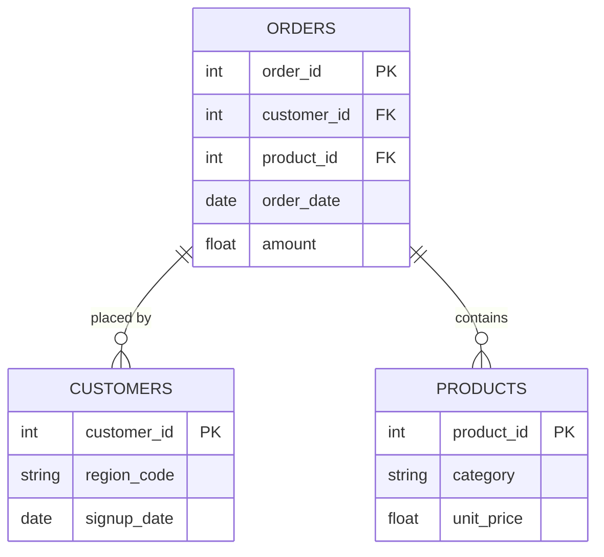

Nigeria-Inter-Bank-Settlement-System (NIBSS) fraud Analytics
> Exploring Financial Transaction Patterns and Fraud Indicators Using Python

---

## ⚙️ Project Overview

Financial fraud remains a major challenge for financial institutions, payment service providers and businesses operating in digital financial environments.

Identifying suspicious transaction patterns and understanding where fraudulent activities occur can help businesses improve monitoring, strengthen risk management and make better-informed decisions.

This project explores a financial transaction dataset containing 1,000,000 transaction records and 29 columns using Python.

The objective is to investigate transaction behavior, examine fraudulent and legitimate transactions, identify patterns across payment channels and customer segments, and communicate findings through data analysis and visualizations.

The project demonstrates an end-to-end exploratory data analysis workflow, from data inspection and cleaning to analysis, visualization and reporting.


---

## Business Problem

  Financial institutions process large volumes of transactions across multiple payment channels.

However, understanding the distribution and characteristics of fraudulent transactions can be challenging without proper data exploration.

This project addresses the following questions:

What proportion of transactions are classified as fraudulent?
How are fraudulent transactions distributed across payment channels?
Which transaction channels account for the highest number of reported fraud cases?
What patterns can be observed across merchant categories?
How do fraudulent transactions vary across customer age groups?
Are there differences in fraudulent activity across days of the week?
What data quality issues should be considered before further analysis or predictive modelling? 


## Project Objectives
  
  ✅ Inspect and understand the structure of the transaction dataset.
  ✅ Identify missing values and duplicate records.
  ✅ Examine the distribution of fraudulent and legitimate transactions.
  ✅ Analyze fraud patterns across transaction channels.
  ✅ Investigate transaction patterns across merchant categories.
  ✅ Explore fraud distribution across customer age groups and weekdays.
  ✅ Explore fraud distribution across customer age groups and weekdays.
  ✅ Identify data quality considerations and opportunities for further investigation.

  ## Dataset Information
Attribute                     Description

Dataset	                  NIBSS Fraud Dataset
Source                         	Kaggle
Creator	                Josiah Endurance Owolabi
Records                        1,000,000
Columns	                          29
Target                    variable	is_fraud
Analysis type          	Exploratory Data Analysis
License                        CC BY-SA 4.0


## Tools Used
1. Python
2. Jupyter Notebook
4. Pandas
5. Numpy
6. Matplotlib
7. Seaborn


Original Dataset: [NIBSS Fraud Dataset on Kaggle](https://www.kaggle.com/datasets/hendurhance/nibsss-fraud-dataset)

The dataset is used for portfolio and educational purposes. Please refer to the original Kaggle page for the dataset's attribution and licensing details


## Key Findings
1. 1 million transaction records analyzed.
2. 3,000 fraudulent transactions identified.
3. 0.3% of transactions were labelled fraudulent.
4. Mobile recorded the highest fraud count, with 1,496 cases.
5. No fully duplicated rows were detected.


---

## Project Workflow

The analysis followed these stages:

##  1. Data Loading and Inspection
Imported the dataset into Python.
Examined the number of rows and columns.
Reviewed column names and data types.
Inspected sample records.
##  2. Data Quality Assessment
Checked for missing values.
Investigated duplicate records.
Examined inconsistencies in relevant fields.
Considered appropriate handling of missing fraud-related information.
##  3. Exploratory Data Analysis

Investigated the distribution of fraudulent transactions across:

* Fraudulent versus legitimate transactions.
* Transaction channels.
* Merchant categories.
* Customer age groups.
* Days of the week.
* Available fraud technique classifications.
## 4. Data Visualisation

Created visual representations to make transaction patterns easier to understand and communicate.

## 5. Findings and Recommendations

Summarised the observations, highlighted data quality considerations and identified opportunities for more advanced fraud analysis.

## Fraud Distribution Across Transaction Channels

The highest fraud case counts were observed in the following channels:

Transaction            Channel	Fraud Cases
Mobile                        1,496
Web	                          687
POS	                          551
IB	                           168
ECOM	                         76
ATM	                          22


##Important observation:## Mobile transactions accounted for the highest number of fraud cases in the dataset. However, fraud counts alone do not establish that a channel is riskier. Transaction volumes and fraud rates by channel should also be examined.

## 3. Project Scope & Tools

### Scope

<!--
  WHAT GOOD LOOKS LIKE:
  In Scope: "Transaction-level data for Regions A–E, Jan 2023–Jun 2024.
             Analysis covers revenue, return rates, and product category performance."
  Out of Scope: "Customer demographics and marketing spend data were excluded -
                 demographic data was incomplete for two regions, and marketing
                 data sits in a separate system outside this engagement."

  WHAT TO AVOID:
  ❌ Leaving Out of Scope blank. This is the section that protects your credibility.
     If you don't define the fence, reviewers assume you missed things.


| Dimension | Details |
|-----------|---------|
| **In Scope** |  Transaction Destination - Receiver characteristics, fund flow patterns, suspicious destination profiling 
Transaction Flow - Network visualization, suspicious pairing identification
Origination - Sender balance changes, account behavior patterns, balance depletion analysis|
| **Out of Scope** |Geographic dat - Cannot perform geospatial fraud hotspot analysis
Demographics - Cannot profile fraud by customer segments
Transaction narrative - Cannot analyze fraud by transaction intent
No merchant category or ID - Cannot identify high-risk merchant types|
| **Time Period** | From March 2st |
<!----| **Granularity** | [Unit of analysis - row-level, daily aggregates, per-user, etc.] |---->

<!--### Tools & Technologies

<!--
  List only what you actually used on this project.
  This is not your skills section - it's the project's technical context.


| Category | Tool(s) Used |
|----------|-------------|
| Data Storage | CSV files |
| Data Processing | Python, Excel|
| Analysis | pandas, dplyr, |
| Visualization | Matplotlib, Tableau, Power BI|
| Version Control | Git / GitHub] |
| Documentation | [e.g., Markdown, Notion] |

---

## 4. Repository Structure

```
[project-root]/
│
├── data/
│   ├── raw/                  # Original, unmodified source data - never edited
│   ├── processed/            # Cleaned and transformed data
│   └── external/             # Reference data, lookup tables, third-party files
│
├── notebooks/                # Jupyter, R Markdown, or Colab notebooks
│
├── scripts/                  # Reusable .py, .R, or .sh processing files
│
├── queries/                  # SQL files (retain this folder for SQL-heavy projects)
│   ├── exploratory/          # Ad-hoc or investigative queries
│   ├── transformations/      # Cleaning and reshaping logic
│   └── final/                # Production-ready or presentation queries
│
├── reports/                  # Final outputs: PDFs, slide decks, Word docs
│
├── visuals/                  # Exported charts, dashboard screenshots, ERD diagrams
│
├── docs/                     # Data dictionaries, schema notes, reference material
│
├── project_metadata.yml      # Machine-readable metadata (optional)
└── README.md                 # You are here
```

> ⚠️ *Delete folders you didn't use. An empty folder is worse than no folder.*
> SQL-heavy projects: keep `queries/`. Analysis-only projects: keep `notebooks/`. Both? Keep both.

---

## 5. Data Workflow

<!--
  Show how data moved through your project - from source to output.
  Every transformation decision should be traceable here.

  WHAT GOOD LOOKS LIKE:
  1. Source: "Monthly CSV exports pulled from the internal POS system.
              Five files, one per region, covering Jan 2023–Jun 2024."
  2. Ingestion: "Loaded into Python using pandas. Files concatenated into
                 a single dataframe (approx. 340,000 rows)."
  3. Cleaning: "Removed 1.2% of rows with null transaction IDs.
                Standardised date formats across regional files.
                Resolved product category naming inconsistencies (3 variants → 1)."
  4. Transformation: "Created a returns_rate field at product-category level.
                      Aggregated to weekly and regional grain for trend analysis."
  5. Analysis: "Descriptive statistics, regional comparison, return rate
                segmentation by product category."
  6. Output: "Summary report (PDF), annotated notebook, processed CSV."

  WHAT TO AVOID:
  ❌ "Data was cleaned and analysed." (No chain. No decisions. No trust.)


[Data Source(s)]
      ↓
[Ingestion / Collection Method]
      ↓
[Cleaning & Transformation]
      ↓
[Analysis / Modelling / Querying]
      ↓
[Output / Visualisation / Reporting]
```

1. **Source:** [Where did the data come from? Format, size, access method.]
2. **Ingestion:** [How was it brought in?]
3. **Cleaning:** [What issues did you find and fix?]
4. **Transformation:** [What new fields, aggregations, or structures did you create?]
5. **Analysis:** [What methods - statistical, visual, query-based, model-based?]
6. **Output:** [What form do the results take?]

---

## 6. Data Model & Schema

<!--
  Define your fields so that someone reading your analysis can follow along
  without digging through your code.

  WHAT GOOD LOOKS LIKE (one row example):
  | transaction_id | string | Unique identifier per sales transaction | TXN-00482 |
  | return_flag    | boolean | Whether the transaction included a return | TRUE |
  | region_code    | string | Two-letter identifier for store region | "NE" |

  WHAT TO AVOID:
  ❌ Skipping this section because "the field names are self-explanatory."
     They're not. Not to a reviewer. Not to you in six months.

  📌 FOR SQL PROJECTS: If you have multiple tables, create one block per table.
     Describe join keys and relationships here. Your ERD (Section 7) will
     visualise what this section describes in text.

  📌 FOR NON-SQL PROJECTS: Describe the shape of your dataset informally
     if a formal schema doesn't apply. Even one paragraph is more helpful than nothing.

### Dataset / Table: `[name]`

| Field Name | Data Type | Description | Example Value |
|------------|-----------|-------------|---------------|
| `[field_1]` | [string / int / date / float / boolean] | [What this field represents] | [Non-sensitive example] |
| `[field_2]` | [string / int / date / float / boolean] | [What this field represents] | [Non-sensitive example] |
| `[field_3]` | [string / int / date / float / boolean] | [What this field represents] | [Non-sensitive example] |

> **Row count (approx.):** [X rows]
> **Date range:** [Start] – [End]
> **Key join / relationship:** [e.g., `orders.customer_id` → `customers.id`]

*Add additional table blocks as needed for multi-table projects.*

---

## 7. ERD - Entity Relationship Diagram
### *(Primarily for SQL Projects - remove this section if not applicable)*

<!--
  An ERD shows how your tables connect to each other visually.
  It is the fastest way for a reviewer to understand the data structure
  of a SQL project without reading every query.

  HOW TO INCLUDE YOUR ERD:
  Option A - Image embed (most common):
    Export your ERD from dbdiagram.io, DBeaver, Lucidchart, or similar.
    Save to /visuals/erd.png and reference it below.

  Option B - dbdiagram.io code block (version-controllable):
    Paste your schema definition code directly in the fenced block below.
    Anyone can paste it into dbdiagram.io to regenerate the visual.

  Option C - Mermaid diagram (renders natively in GitHub):
    Use the mermaid code block syntax below.
    GitHub will render this as a diagram automatically.

  PICK ONE. Don't use all three. Delete the options you don't use.

### Option A - Embedded Image

*[Brief caption: e.g., "Three-table schema - orders, customers, and products joined on shared IDs."]*

---

### Option B - dbdiagram.io Schema Definition
```
Table orders {
  order_id    int     [pk]
  customer_id int     [ref: > customers.customer_id]
  product_id  int     [ref: > products.product_id]
  order_date  date
  amount      float
}

Table customers {
  customer_id int  [pk]
  region_code string
  signup_date date
}

Table products {
  product_id   int    [pk]
  category     string
  unit_price   float
}
```
*Paste this into [dbdiagram.io](https://dbdiagram.io) to view the visual.*

---

### Option C - Mermaid Diagram *(renders on GitHub)*


---

**Table Relationships Summary:**

| Relationship | Join Key | Type |
|-------------|----------|------|
| `orders` → `customers` | `customer_id` | Many-to-One |
| `orders` → `products` | `product_id` | Many-to-One |
| [Add rows as needed] | | |

---

## 8. Analysis & Metrics

<!--
  Explain what you measured and how - before you share what you found.

  WHAT GOOD LOOKS LIKE:
  Metric: "Customer Return Rate"
  Definition: "Number of transactions flagged as returns divided by total
               transactions, calculated at product-category and regional grain."
  Why It Matters: "Return rate - not sales volume - was hypothesised to
                  explain regional revenue gaps. This metric tests that hypothesis."

  WHAT TO AVOID:
  ❌ Defining a metric only in code: SUM(returns) / COUNT(transaction_id)
     That's an implementation. Write the plain-language definition here.
     Both belong in your project - the definition in the README,
     the implementation in the code.


### Analytical Approach

[Describe how you approached the analysis. Were you exploring patterns? Testing a hypothesis? Building and validating a pipeline? Be honest about your method - exploratory work is valid, just call it that.]

### Key Metrics Defined

| Metric | Plain-Language Definition | Why It Matters |
|--------|--------------------------|----------------|
| `[Metric 1]` | [What it measures, in one sentence] | [What decision or question it answers] |
| `[Metric 2]` | [What it measures, in one sentence] | [What decision or question it answers] |
| `[Metric 3]` | [What it measures, in one sentence] | [What decision or question it answers] |

### Methods Used

- [e.g., Descriptive statistics - distribution, central tendency, outlier detection]
- [e.g., Trend analysis across [time period]]
- [e.g., Segmentation / group comparison by [dimension]]
- [e.g., Correlation analysis between [variable A] and [variable B]]
- [e.g., SQL window functions for [specific aggregation]]
- [e.g., Custom aggregation or transformation logic in [tool]]

---

## 9. Key Insights

<!--
  Findings + implications. Not just what happened - what it means.

  WHAT GOOD LOOKS LIKE:
  ✅ "Return rates, not sales volume, explain Region A's underperformance.
      Region A's return rate on home goods was 34% - more than double the
      company average. Revenue was not lost at the point of sale; it was
      lost post-sale through refunds. This points to a fulfilment or
      product quality issue specific to that region, not a demand problem."

  WHAT TO AVOID:
  ❌ "Region A had lower revenue than other regions in Q4."
     (That's an observation. It describes what happened.
      An insight says what it means and where to look next.)

  Aim for 3–6 insights. Quality over quantity.


**Insight 1: [Short descriptive headline]**
[What you found + what it suggests. One short paragraph.]

**Insight 2: [Short descriptive headline]**
[What you found + what it suggests.]

**Insight 3: [Short descriptive headline]**
[What you found + what it suggests.]

**Insight 4 (if applicable): [Short descriptive headline]**
[What you found + what it suggests.]

---

## 10. Recommendations


  Action-oriented. Addressed to a real audience.
  Tied explicitly to the insight that supports each one.

  WHAT GOOD LOOKS LIKE:
  Priority: High
  Recommendation: "Conduct a fulfilment audit for home goods deliveries
                   in Region A - specifically investigating whether returns
                   correlate with a particular warehouse, carrier, or SKU batch."
  Based On: Insight 1 - return rate anomaly in Region A
  Owner: Operations / Supply Chain team

  WHAT TO AVOID:
  ❌ "Improve the return rate."
     (Not actionable. Doesn't say who, how, or where to start.)
  ❌ "Further analysis is needed."
     (This is a placeholder, not a recommendation.)


| Priority | Recommendation | Based On | Suggested Owner |
|----------|---------------|----------|-----------------|
| High | [Specific, actionable step] | [Insight it comes from] | [Who should act] |
| Medium | [Specific, actionable step] | [Insight it comes from] | [Who should act] |
| Low | [Exploratory or longer-term suggestion] | [Insight it comes from] | [Who should act] |

---

## 11. Assumptions & Limitations

<!--
  WHAT GOOD LOOKS LIKE:
  Assumption: "Transaction records were assumed to be complete for all five regions.
               No validation was performed against source system record counts."
  Limitation: "The analysis cannot distinguish between returns initiated by
               the customer vs. returns initiated by the business (e.g., recalls).
               If business-initiated returns are concentrated in Region A, the
               return rate finding may reflect a policy decision, not a quality issue."

  WHAT TO AVOID:
  ❌ Leaving this section blank or writing "None known."
     Every project has limitations. Documenting them is a sign of
     analytical maturity - not a confession of failure.
--

### Assumptions
- [What did you treat as true without being able to verify?]
- [What simplifications did you make for scope or feasibility?]
- [What domain rules or definitions did you accept as given?]

### Limitations
- [What gaps exist in the data?]
- [What analysis was out of scope but could affect interpretation?]
- [What would a more rigorous version of this project include?]
- [Are there known biases in the data source or collection method?]

> *The goal here is pre-emptive Q&A. What would a thoughtful skeptic push back on? Document the answer here, before they ask.*

---

## 12. Future Enhancements


  WHAT GOOD LOOKS LIKE:
  ✅ "Automate the monthly data pull from the POS export folder using
      a scheduled Python script, replacing the current manual process."
  ✅ "Expand the return rate analysis to include carrier-level data,
      which was unavailable in this dataset but exists in the logistics system."

  WHAT TO AVOID:
  ❌ "Add a machine learning model."
     (Vague, and disconnected from the actual findings of this project.)
  ❌ Listing aspirational features that don't follow logically from the work.
--

- [ ] [Enhancement 1 - specific and traceable to a real gap in this project]
- [ ] [Enhancement 2]
- [ ] [Enhancement 3]
- [ ] [Enhancement 4]

---

## 13. Deliverables

| Deliverable | Description | Location |
|-------------|-------------|----------|
| [Name] | [What it contains] | [`/path/to/file`] |
| [Name] | [What it contains] | [`/path/to/file`] |
| [Name] | [What it contains] | [`/path/to/file`] |

--->

## 14. Author

**Emmanuel Ejike**
Data Scientist & Cloud Engineer
- 🔗 linkedin- (https://www.linkedin.com/in/emmanuel-ejike-690319314)
- 💼 Link to Project- (https://colab.research.google.com/drive/1A7ZILuiKjDPdEucTW7sX8uNuUjnyMNer#scrollTo=be3874b5-d76f-4e53-988c-cd426cb29ab2)
- 📧 ejemmanuelejike@hotmail.com

---

*Last updated: [April 2026]* Currently still working on....
